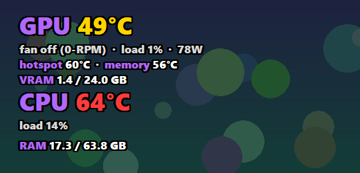
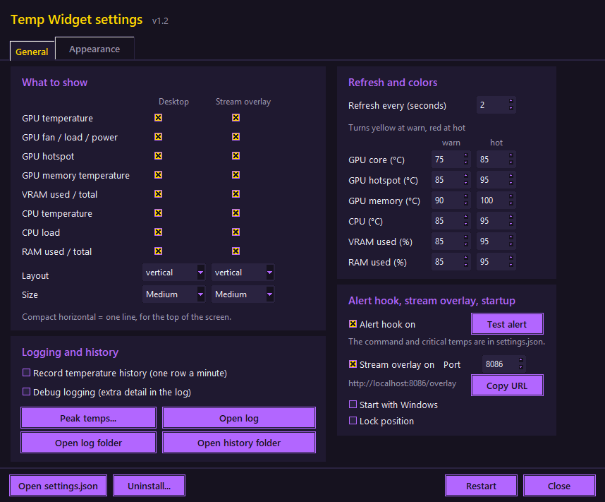
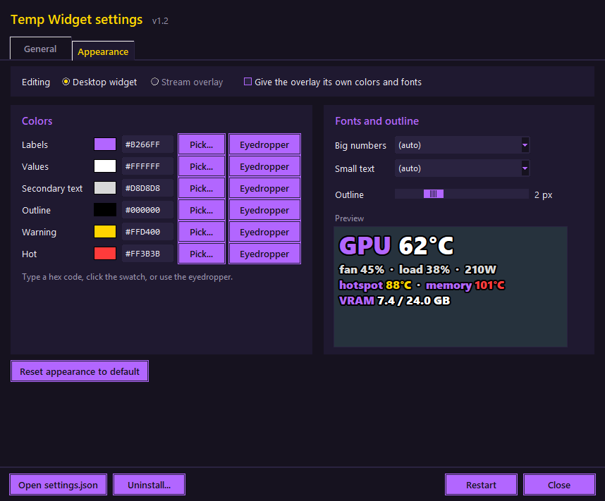
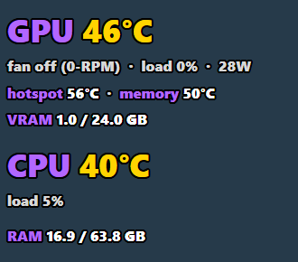
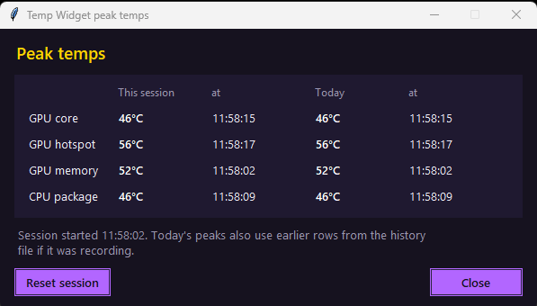

# SuperZydan Temp Widget

A small always-on-top overlay for Windows that shows GPU, CPU and memory stats with a see-through background. It also serves the same readout as a web page you can add to Streamlabs or OBS as a browser source.

It is one Python file that uses only the standard library (tkinter), so there is nothing to `pip install`.



White text with a thick black outline, purple labels, yellow for warm and red for hot. The yellow and red here are only showing because the warning limits were lowered for the screenshot.

It follows Windows display scaling. The widget stays sharp at 100%, 125%, 150% and up, and resizes itself when you move it to a monitor with a different scale.

## What it shows

- GPU temperature, fan, load and power draw (nvidia-smi)
- GPU hotspot and GPU memory junction temperature (LibreHardwareMonitor, hidden if your card doesn't report them)
- VRAM used / total (nvidia-smi)
- CPU temperature and load (LibreHardwareMonitor)
- System RAM used / total

Every line can be switched off, separately for the desktop widget and the stream overlay.

A compact one-line layout is available for the top of the screen:


## Requirements

- Windows 10 or 11
- An NVIDIA GPU with the driver installed (the widget calls `nvidia-smi`)
- Python 3 with tkinter. Tested on 3.11 and 3.13. The python.org installer includes tkinter.
- [LibreHardwareMonitor](https://github.com/LibreHardwareMonitor/LibreHardwareMonitor/releases) with its web server turned on, for CPU temperature and load and the GPU hotspot and memory temperatures

Without LibreHardwareMonitor the widget still shows GPU temperature, fan, load, power, VRAM and RAM. The CPU lines show a short hint instead.

## Setup

1. Download or clone this repository somewhere permanent.
2. Install LibreHardwareMonitor and start it. CPU temperatures need admin rights, so run it as administrator.
3. In LibreHardwareMonitor open **Options > Remote Web Server** and tick **Run** (default port 8085). Also useful: **Run On Windows Startup** and **Start Minimized**.
4. Double-click `Start-Temp-Widget.bat`. It finds Python through the `py` launcher or `pythonw` on your PATH and runs the widget without a console window.
5. On the first run the widget creates `settings.json` next to the script (a copy of `settings.example.json`).

Left-drag the widget to move it. Right-click it for the menu: Settings, layout, size, lock position, start with Windows, copy the overlay URL, test the alert hook, peak temps, open the log, restart, quit.

To start it with Windows, use **Start with Windows** in the menu or the Settings window. That puts a small `.vbs` file in your Startup folder. Untick it to remove the file.

If the widget is already running, starting it a second time does nothing. To start a fresh copy, for example after updating the files, use **Restart** in the menu or the Settings window.

## Uninstall

Open **Settings...** and click **Uninstall...**. After you confirm, it removes what makes the widget start or show up:

- the `Temp Widget.vbs` entry in your Startup folder
- the scheduled task named `SuperZydan Temp Widget`, if you made one
- desktop shortcuts (yours or the all-users desktop) that start this widget

Each of these is only removed if it starts the copy you are uninstalling. One that points at a copy in another folder is left alone.

Tick **Also delete my settings, logs and history** to remove `settings.json`, the log files and the history CSVs as well. It is off by default. The widget then closes and shows what it removed, what it left alone and anything it could not remove (a scheduled task or a shared desktop shortcut made as administrator may need to be deleted by hand).

It never deletes the program folder. Delete that yourself afterwards. LibreHardwareMonitor is a separate program, so uninstall it on its own if you no longer need it.

## Settings window

Right-click the widget and pick **Settings...**. Changes apply right away and are saved to `settings.json`.



The **General** tab has:

- which lines to show, with one column for the desktop widget and one for the stream overlay
- layout (vertical or compact horizontal) and size, for each of them
- refresh rate
- warn and hot limits for each sensor (yellow at warn, red at hot)
- alert hook on/off and a test button
- logging and history: record temperature history, debug logging, peak temps, and buttons that open the log, the log folder and the history folder
- stream overlay on/off, port, and a button that copies the URL
- start with Windows, lock position

Along the bottom: open `settings.json`, [Uninstall](#uninstall), Restart and Close.

The **Appearance** tab has:



- colors for labels, values, secondary text, outline, warning and hot. Each one has a swatch, an editable hex code, the Windows color dialog, and an eyedropper. For the eyedropper, click **Eyedropper**, then click any pixel on any monitor. Esc or right-click cancels.
- a font for the big numbers and one for the small text, picked from your installed fonts, with a live preview. `(auto)` uses Montserrat Black if you have it, then Segoe UI Black, Arial Black, Arial.
- outline thickness from 0 (no outline) to 8 pixels (at 100% display scaling, it grows with the scale)
- **Give the overlay its own colors and fonts**: when off, the overlay uses the desktop look. When on, switch the **Editing** option to Stream overlay to change the overlay separately.
- **Reset appearance to default** puts the white, purple, yellow look back for whichever one you are editing.

## Stream overlay (Streamlabs / OBS)

The widget runs a tiny web server on `127.0.0.1` only (nothing else on your network can reach it). The default address is:

```
http://localhost:8086/overlay
```

In Streamlabs Desktop or OBS:

1. Add a source, choose **Browser**.
2. Paste the URL above. Leave the custom CSS alone, the page background is already transparent.
3. Set a size that fits, for example 420 x 320 for the vertical layout. The horizontal layout needs a wide, short source, for example 1400 x 70.
4. Drag it where you want it.



(The dark background in this picture is only there so the white text shows up. In the browser source it is transparent.)

The widget has to be running for the overlay to work. The page keeps its last picture if the widget stops, and updates again when it comes back.

You can adjust the page with URL options:

| Option | Example | Does |
| --- | --- | --- |
| `layout` | `?layout=horizontal` | `vertical` or `horizontal` |
| `size` | `?size=Large` | `Small`, `Medium` or `Large` |
| `scale` | `?scale=1.5` | multiply everything by this |
| `bg` | `?bg=%23222222` | solid background, for previewing in a normal browser tab |

Which lines show, the default layout and size, and the overlay's colors and fonts come from `settings.json` (the `overlay` section).

If port 8086 is taken by something else, change `overlay.port` in the Settings window or in `settings.json`. The widget keeps running without the overlay if it can't bind the port, and writes the reason to `temp_widget.log`.

## settings.json

`settings.json` is created on the first run and is not committed to git (it holds your window position and, if you set one, your alert command). `settings.example.json` shows every option with its default. Edit the file by hand while the widget runs and it reloads within a couple of seconds. A bad value falls back to the default.

| Key | Meaning |
| --- | --- |
| `refresh_seconds` | how often sensors are read, 1 to 60 |
| `layout` | `vertical` or `horizontal` |
| `size` | `Small`, `Medium` or `Large` |
| `x`, `y`, `locked` | window position in screen pixels, and whether dragging is disabled |
| `colors` | `label`, `text` (values), `detail` (secondary text), `warn`, `hot`, `outline`, as `#RRGGBB` |
| `fonts` | `big` and `small` font names, empty for automatic |
| `outline_width` | outline thickness in pixels at 100% scaling, 0 to 8 |
| `show` | true/false for each line: `gpu_temp`, `gpu_details`, `gpu_hotspot`, `gpu_memory_temp`, `vram`, `cpu_temp`, `cpu_load`, `ram` |
| `thresholds` | `warn` and `hot` for `gpu`, `gpu_hotspot`, `gpu_memory`, `cpu` (in °C) and `vram`, `ram` (in % used) |
| `lhm_url` | LibreHardwareMonitor's data address, default `http://localhost:8085/data.json` |
| `history` | `enabled`, record the history CSV (default false) |
| `logging` | `debug`, extra detail in the log (default false) |
| `overlay` | `enabled`, `port`, `layout`, `size`, `scale`, `show`, and `own_appearance` with its own `colors`, `fonts` and `outline_width` |
| `alerts` | see below |

## Logs, history and peak temps

**Log.** `temp_widget.log` sits next to the script (see Notes for `--settings` and `--log`). On every start it records the widget version, Python version, GPU name, and whether `nvidia-smi` and LibreHardwareMonitor were found. After that it only writes when something changes: alerts, a sensor source going away or coming back (one line each time, no repeats), and errors. Any crash or unexpected error is written with its full traceback, including errors inside the Settings window and background threads. When the file passes 500 KB it is renamed to `temp_widget.log.old`.

**Debug logging.** Tick **Debug logging** in Settings (`"logging": {"debug": true}`) to also log every poll with its readings, settings changes, overlay requests and alert progress. Leave it off normally.

**Temperature history.** Tick **Record temperature history** in Settings (`"history": {"enabled": true}`) and the widget adds one row a minute to `history/YYYY-MM.csv`, one file per month:

```
time,gpu_c,gpu_hotspot_c,gpu_memory_c,cpu_c,vram_used_gb,ram_used_gb
2026-11-20 14:31:09,62.0,71.4,68.0,55.0,7.4,24.8
```

Empty cells mean that sensor wasn't available. It is off by default and the folder is not committed to git.

**Peak temps.** Right-click > **Peak temps...** (or the button in Settings) shows the highest GPU core, hotspot, memory and CPU temperatures for this session and for today, and the time each one happened. Peaks are tracked whether or not history is recording. If history was recording earlier today, those rows are counted too after a restart.

**Open log / Open log folder** are in the right-click menu and in Settings.



## Alert hook

Critical alerts can go to whatever you already use: a voice, a Discord channel, your own script or an AI agent. The widget runs one command when a temperature is high enough to be a real problem, and you decide what that command does. It is not for every warm reading.

Defaults in `settings.example.json`:

| Sensor (`id`) | Critical temp |
| --- | --- |
| GPU core (`gpu`) | 88 °C |
| GPU hotspot (`gpu_hotspot`) | 100 °C |
| GPU memory junction (`gpu_memory`) | 100 °C |
| CPU package (`cpu`) | 100 °C |

The rules:

- The sensor has to stay at or above its critical temp for `hold_seconds` (default 10) without dipping below. A short spike does nothing.
- After it fires, that sensor stays quiet for `cooldown_seconds` (default 300, so 5 minutes). Each sensor has its own cooldown.
- Set a sensor's value to `null` (or 0) to turn that one off. `"enabled": false` turns all of it off.
- `alerts.command` is empty by default, so nothing runs until you set it. Alerts are still written to `temp_widget.log`.

`alerts.command` can be a list (recommended, no quoting problems) or a single string. These placeholders are replaced:

| Placeholder | Value |
| --- | --- |
| `{sensor}` | `gpu`, `gpu_hotspot`, `gpu_memory` or `cpu` |
| `{label}` | `GPU core`, `GPU hotspot`, `GPU memory` or `CPU package` |
| `{temp}` | the temperature, rounded, for example `102` |
| `{threshold}` | the critical temp that was crossed |

The same values are also set as environment variables: `TEMPWIDGET_SENSOR`, `TEMPWIDGET_LABEL`, `TEMPWIDGET_TEMP`, `TEMPWIDGET_THRESHOLD`.

The command is started directly, not through `cmd.exe`, with no window. Copy one of these into the `alerts` section of your `settings.json` (keep `critical`, `hold_seconds` and `cooldown_seconds` from the example file):

**1. Windows text-to-speech**

```json
"command": [
  "powershell", "-NoProfile", "-Command",
  "Add-Type -AssemblyName System.Speech; (New-Object System.Speech.Synthesis.SpeechSynthesizer).Speak('{label} is at {temp} degrees')"
]
```

**2. Discord webhook message (curl.exe ships with Windows 10 and 11)**

```json
"command": [
  "curl.exe", "-s", "-X", "POST",
  "-H", "Content-Type: application/json",
  "-d", "{\"content\": \"Temp alert: {label} is at {temp} degrees\"}",
  "https://discord.com/api/webhooks/YOUR_WEBHOOK_ID/YOUR_WEBHOOK_TOKEN"
]
```

Create the webhook under Server Settings > Integrations > Webhooks. The webhook URL works like a password, so keep it in `settings.json` (which is not committed) and never in `settings.example.json`.

**3. HTTP POST to your own AI agent or voice assistant**

```json
"command": [
  "curl.exe", "-s", "-X", "POST",
  "-H", "Content-Type: application/json",
  "-d", "{\"sensor\": \"{sensor}\", \"label\": \"{label}\", \"temp\": {temp}, \"threshold\": {threshold}}",
  "http://localhost:PORT/your-endpoint"
]
```

Replace the URL with whatever your agent listens on. If it needs a key, add a header such as `"-H", "Authorization: Bearer YOUR_KEY"` in `settings.json` only. Anything that can run a program works the same way: put its path and arguments in the list.

Use **Test alert hook** in the right-click menu (or **Test alert** in Settings) to run the command once with made-up values. The command comes from your own `settings.json`, so only put commands there that you trust.

## Files

| File | What |
| --- | --- |
| `temp_widget.py` | the widget |
| `Start-Temp-Widget.bat` | launcher, finds Python and starts the widget |
| `settings.example.json` | all options with defaults |
| `temp_widget.ico` | icon for shortcuts |
| `settings.json` | your settings, created on first run |
| `temp_widget.log` | startup report, alerts, source changes and errors, created when needed |
| `history/` | temperature history CSVs, only if you turn recording on |

To make a desktop shortcut, create one to `Start-Temp-Widget.bat` and pick `temp_widget.ico` as its icon.

## Notes

- Only NVIDIA GPUs are read through nvidia-smi. Hotspot and memory temps come from LibreHardwareMonitor, so they show up for any card it supports.
- Temperatures are in °C.
- Command line options: `--settings <file>` uses a different settings file (and allows a second widget), `--open-settings [general|appearance]` opens the Settings window on start, `--log <file>` writes the log somewhere else, `--restarted` (added by **Restart**) waits up to 10 seconds for the old widget to exit, `--version` prints the version, `--test-crash main|thread|tk` raises a fake error to check that tracebacks reach the log. A widget started with `--settings` keeps its log (`<settings name>.log`) and history (`<settings name>-history/`) next to that file, so a test copy never writes into your main widget's log.

## Changes

- **v1.2**: Fixed: with Windows display scaling above 100%, lines overlapped and the top line was cut off. Spacing now comes from the real font sizes, the widget is per-monitor DPI aware and redraws when it moves to a monitor with a different scale. New **Restart** (Settings and right-click menu) and **Uninstall** (Settings). If your monitors use scaling other than 100%, the widget may appear in a slightly different spot the first time you run this version. Drag it back once and it stays.
- **v1.1.1**: when `nvidia-smi` times out or fails the widget now says "nvidia-smi not responding" ("not found" is only for a missing program). A widget started with `--settings` writes its log and history next to that settings file instead of into the main widget's. `--log <file>` picks the log location. Open log folder opens the folder the log is really in.
- **v1.1**: logging (startup report, source changes, tracebacks for every crash, debug option), optional temperature history, peak temps window, open log shortcuts, version shown in Settings. Fixed: a second widget could silently share the overlay port instead of reporting that it was in use.
- **v1.0**: first release.

## License

MIT, see `LICENSE`.

Questions or ideas? Reach out: superzydanofficial [at] gmail [dot] com
